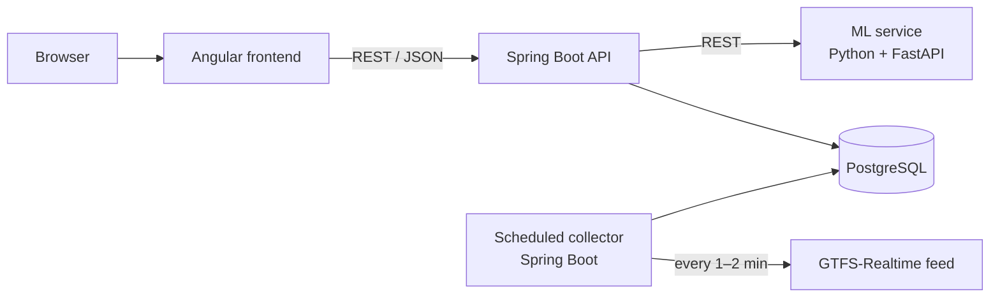

# 🚆 DelayTracker

**How reliable is public transport in the Ruhrgebiet, and will my train be late tomorrow morning?**

Ruhr Transit Reliability collects realtime delay data for buses, trams and trains in the Ruhr area. It shows how punctual each line and stop really is and predicts delays for your daily commute with machine learning.

> 🚧 **Status: in development.** We started in October 2026. Follow the progress in the [roadmap](#-roadmap) and on our project board.

<!-- Add after CI is set up (week 4):

-->

---

## ✨ Features (planned)

| Feature | Description |
|---|---|
| 📊 **Reliability dashboard** | Punctuality score, average delay and delay heatmap (by hour and weekday) for every line |
| 🗺️ **Map** | Stops coloured by reliability, so you can see where delays happen |
| ⭐ **My commute** | Save favourite connections after logging in |
| 🔮 **Delay forecast** | ML model predicts the expected delay for a line, stop and time |
| 📧 **Morning alerts** | E-mail when your commute is likely to be delayed |
| 🛠️ **Admin view** | Status of the data collector, last import, errors |

## 🧰 Tech stack

| Layer | Technologies |
|---|---|
| Frontend | Angular, TypeScript, HTML, SCSS, Angular Material, Chart.js, Leaflet |
| Backend | Java 21, Spring Boot (Web, Data JPA, Security/JWT, Validation, Scheduling, Actuator) |
| Database | PostgreSQL, Flyway |
| Machine learning | Python, pandas, scikit-learn, FastAPI |
| DevOps | Docker, Docker Compose, GitHub Actions, Caddy |
| Testing | JUnit 5, Mockito, Testcontainers, WireMock, Playwright, pytest |

## 🏗️ Architecture



1. A **scheduled collector** reads the realtime feed every 1–2 minutes and stores planned and actual times in PostgreSQL.
2. The **Spring Boot API** turns this data into statistics and serves it to the frontend.
3. The **ML service** is trained on the collected history and returns delay forecasts.
4. The **Angular frontend** shows dashboards, maps and the personal commute view.

## 🚀 Getting started

> The setup below is the target state and will work once the first version is merged.

### Prerequisites

- [Docker Desktop](https://www.docker.com/products/docker-desktop/)
- For development without Docker: JDK 21, Node.js (LTS), Angular CLI, Python 3.12

### Run everything with Docker

```bash
git clone https://github.com/<org-or-user>/ruhr-transit-reliability.git
cd ruhr-transit-reliability
cp .env.example .env        # adjust values if needed
docker compose up --build
```

| Service | URL |
|---|---|
| Frontend | http://localhost:4200 |
| Backend API | http://localhost:8080/api |
| API docs (Swagger UI) | http://localhost:8080/swagger-ui.html |
| Health check | http://localhost:8080/actuator/health |
| ML service | http://localhost:8000/docs |

### Run parts separately (development)

```bash
# Database only
docker compose up -d db

# Backend
cd backend && ./mvnw spring-boot:run

# Frontend
cd frontend && npm install && ng serve

# ML service
cd ml && pip install -r requirements.txt && uvicorn app.main:app --reload
```

## 📁 Project structure

```
ruhr-transit-reliability/
├── frontend/            Angular app
├── backend/             Spring Boot API + data collector
├── ml/                  Notebooks, training scripts, FastAPI prediction service
├── docs/                Architecture, decisions, learning notes
├── .github/workflows/   CI pipeline
├── docker-compose.yml
├── .env.example
└── README.md
```

## 🗺️ Roadmap

- [ ] **Setup:** repo, Docker Compose, "hello world" through all layers
- [ ] **Data check:** verify the realtime feed and design the database schema
- [ ] **Backend:** entities, Flyway migrations, REST API, scheduled collector
- [ ] **CI:** GitHub Actions builds and tests every pull request
- [ ] **Dashboard:** line statistics and charts in Angular
- [ ] **Accounts:** registration, login (JWT), favourite connections
- [ ] **v0.1 online:** first public demo
- [ ] **ML:** baseline vs. model, FastAPI prediction service, forecast in the UI
- [ ] **Map and alerts:** Leaflet map, morning e-mail notifications
- [ ] **Quality:** test coverage, error handling, responsive design
- [ ] **v1.0 release:** monitoring, backups, demo video

## 🧪 Testing

```bash
cd backend && ./mvnw verify          # unit + integration tests (Testcontainers)
cd frontend && npm test              # component and service tests
cd frontend && npx playwright test   # end-to-end tests
cd ml && pytest                      # feature and API tests
```

## 🤝 How we work

- `main` is always deployable. Nobody pushes directly to `main`.
- Each task gets its own branch, e.g. `feature/lines-dashboard` or `fix/collector-timeout`.
- Every change goes through a **pull request** with at least one review and green CI.
- Tasks are tracked on the GitHub Projects board.
- Commit messages are short and in the imperative, e.g. `Add delay statistics endpoint`.

## 📡 Data sources

- Realtime and timetable data: [gtfs.de](https://gtfs.de), licensed under [CC BY-SA 4.0](https://creativecommons.org/licenses/by-sa/4.0/). Data is provided without guarantee of correctness or completeness.
- Weather data (planned): [Bright Sky](https://brightsky.dev/) / Deutscher Wetterdienst

This is a student project and is not affiliated with VRR, Deutsche Bahn or any transport company.

## 👥 Team

| | Name | GitHub |
|------|---|
| 👤 | Mohammed Qubaja | [@Qubaja](https://github.com/Qubaja) |
| 👤 | Omar Almasri | [@username](https://github.com/omar-almasri-cpu) |

Computer science students at TU Dortmund.
